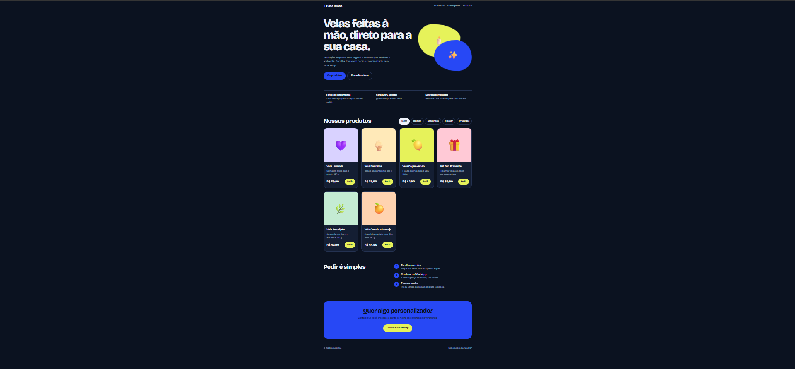

# Template de Loja com Pedidos pelo WhatsApp

Um site de loja **simples, moderno e gratuito** para quem quer vender online sem pagar mensalidade e sem saber programar. O cliente escolhe o produto, toca em **Pedir** e a conversa abre no seu WhatsApp com a mensagem já pronta.

**Demonstração:** https://yanfurlan.github.io/template-loja-whatsapp/



## O que está incluído

- Visual moderno, que funciona bem no celular e no computador
- Modo escuro automático
- Pedidos direto no WhatsApp, sem taxas e sem intermediários
- Filtro de produtos por categoria
- Um único arquivo (`index.html`), sem instalar nada
- Fácil de personalizar: nome, textos, cor, produtos e fotos em um só lugar

## Como usar

1. Clique em **Use this template** (botão verde no topo desta página) e depois em **Create a new repository**.
2. Abra o arquivo `index.html` e procure por `const STORE = {`.
3. Troque as informações da sua loja:

```js
const STORE = {
  name: "Nome da sua loja",
  headline: "Frase principal do site.",
  subtitle: "Uma linha explicando o que você vende.",
  whatsapp: "5511999999999",   // 55 + DDD + número, só dígitos
  city: "Sua cidade, UF",
  accent: "#2748F5",           // cor principal
  perks: [
    ["Vantagem 1", "Explicação curta."],
    ["Vantagem 2", "Explicação curta."],
    ["Vantagem 3", "Explicação curta."]
  ]
};
```

4. Logo abaixo, edite a lista `PRODUCTS`, um produto por linha:

```js
{name:"Nome do produto", desc:"Descrição curta.", price:39.9, cat:"Categoria", emoji:"🕯️", bg:"#E6F25A"}
```

   - Para usar **foto** no lugar do emoji, troque `emoji` por `img:"foto1.jpg"` e coloque a imagem na mesma pasta.
   - O preço usa ponto: `39.9` aparece como R$ 39,90.
   - Para remover um produto, apague a linha dele.

5. Salve e abra o `index.html` no navegador para conferir.

## Como colocar no ar de graça

**GitHub Pages**
1. No seu repositório, vá em **Settings → Pages**.
2. Em **Branch**, escolha `main` e a pasta `/ (root)`, depois clique em **Save**.
3. Em alguns minutos o site fica disponível em `https://SEU-USUARIO.github.io/NOME-DO-REPOSITORIO`.

**Outras opções gratuitas:** [Netlify Drop](https://app.netlify.com/drop) (arraste a pasta e pronto) e [Cloudflare Pages](https://pages.cloudflare.com).

## Dicas para vender mais

- Use fotos claras, com boa luz e fundo limpo.
- Escreva descrições curtas, com tamanho, ingredientes ou material.
- Coloque o link do site na bio do Instagram e no status do WhatsApp.
- Responda rápido: quem pede pelo WhatsApp espera resposta na hora.

## Licença

Distribuído sob a licença MIT. Você pode usar, modificar e distribuir este template, inclusive em projetos comerciais, mantendo o aviso de crédito. Veja o arquivo [LICENSE](LICENSE).
